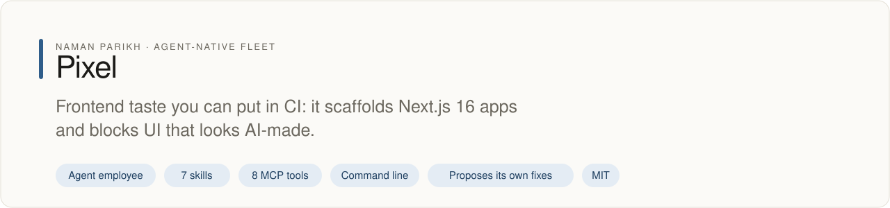
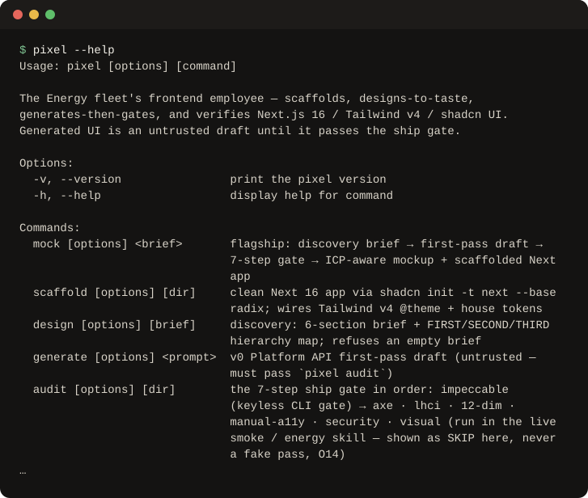
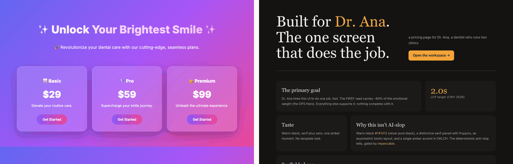

# pixel

<!-- fleet:header:start -->
<p align="center"><picture><source media="(prefers-color-scheme: dark)" srcset="assets/banner-dark.svg"></picture></p>

<p align="center">
<a href="https://github.com/naman10parikh/pixel/actions/workflows/ci.yml"></a>
<a href="https://github.com/naman10parikh/pixel/releases"></a>
<a href="LICENSE"></a>
<a href="#use-it-from-any-coding-agent"></a>
<a href="https://x.com/naman10parikh"></a>
<a href="https://www.linkedin.com/in/naman-parikh1/"></a>
</p>

<p align="center"><a href="#quick-start">Quick start</a> · <a href="https://naman10parikh.github.io/pixel/">Website</a> · <a href="docs/README.md">How it works</a> · <a href="AGENTS.md">AGENTS.md</a> · <a href="llms.txt">llms.txt</a> · <a href="skills/">Skills</a> · <a href="https://github.com/naman10parikh/pixel/discussions">Discussions</a> · <a href="https://github.com/naman10parikh">All projects</a></p>

**Frontend taste you can put in CI: it scaffolds Next.js 16 apps and blocks UI that looks AI-made.**

Pixel is an agent employee, a packaged specialist agent with its own skills, memory and tests. It owns one job: frontend. Coding agents use it through its skills, its MCP server and its command line. A scheduled job runs its evals and proposes fixes. A person makes every change.

_Pixel is part of an agent-native play for agent-native systems that can eventually be recursively self-improving and evolving, operated by agent employees._

<p align="center"></p>
<!-- fleet:header:end -->

Pixel is a frontend designer-engineer for coding agents. Give it a one-line product brief and it hands back a
mockup written for a named user and a clean Next.js 16 app on Tailwind v4 and shadcn, checked so it does not look
AI-made. It is for people and agents who ship web UI and want a taste gate in CI rather than another generator:
every generated screen is an untrusted draft until it passes the gate. Its edge is that gate (`impeccable detect`
plus a 12-dimension design audit), not the generator.

<!-- fleet:use:start -->
## Use it from any coding agent

**Claude Code**: the plugin brings the skills, sub-agents, hooks and MCP server.

```
/plugin marketplace add naman10parikh/pixel
/plugin install pixel@pixel
```

<details><summary>Its MCP server, Codex, Cursor, Gemini CLI, one skill and the command line</summary>

**Its MCP server**, in any MCP client:

```bash
claude mcp add --transport stdio pixel -- npx -y -p github:naman10parikh/pixel pixel-mcp
codex mcp add pixel -- npx -y -p github:naman10parikh/pixel pixel-mcp
```

Cursor (`.cursor/mcp.json`), Gemini CLI (`.gemini/settings.json`) and most other clients take the same command as JSON:

```json
{
  "mcpServers": {
    "pixel": {
      "command": "npx",
      "args": [
        "-y",
        "-p",
        "github:naman10parikh/pixel",
        "pixel-mcp"
      ]
    }
  }
}
```

**Gemini CLI**: the extension brings the context and the MCP server.

```bash
gemini extensions install https://github.com/naman10parikh/pixel
```

**One skill** (7 in all, in [skills/](skills/)), in any agent that reads Agent Skills:

```bash
gemini skills install https://github.com/naman10parikh/pixel --path skills/pixel-anti-slop
git clone --depth 1 https://github.com/naman10parikh/pixel /tmp/pixel && cp -r /tmp/pixel/skills/pixel-anti-slop ~/.claude/skills/
```

**The command line:**

```bash
npx -y -p github:naman10parikh/pixel pixel --help
```

</details>

Codex, Cursor, OpenCode, GitHub Copilot and other agents read [AGENTS.md](AGENTS.md); Claude Code reads [CLAUDE.md](CLAUDE.md) and Gemini CLI reads [GEMINI.md](GEMINI.md), which import it. [llms.txt](llms.txt) maps every surface for agents that read first.
<!-- fleet:use:end -->

## Quick start

One real run, straight from GitHub, in an empty folder. It needs no API key; this run took 47 seconds.

```bash
npx -y -p github:naman10parikh/pixel pixel mock "a pricing page for Dr. Ana, a dentist who runs two clinics" --out ./pixel-demo
```

What it printed, shortened (the full paths cut to `./pixel-demo`):

```
pixel mock → ./pixel-demo  (discover → generate → gate → emit)
[1/4] discover — 6-section brief + a named ICP
pixel design: discovery brief written → ./pixel-demo/brief.md
[3/4] gate — write the ICP-aware mockup + scaffold the app, then the ship gate
  ✓ mockup written ./pixel-demo/mockup/index.html
✓ Next 16 app scaffolded
[4/4] emit — the ICP-aware mockup + scaffolded app under --out
✓ pixel mock done — ICP "Dr. Ana" · mockup + scaffolded app → ./pixel-demo
```

It wrote three things into `./pixel-demo`: `brief.md`, the discovery brief built around the named person (the
output calls that person the ICP, the ideal customer); `mockup/index.html`, a one-page mockup; and `app/`, a
Next.js 16 app on Tailwind v4 and shadcn. It exits 0 only when the anti-slop gate passes. Step 2 skipped the
optional v0 draft because no `V0_API_KEY` was set. Set `E2B_API_KEY` to run the gate inside an E2B sandbox.

Every command, second:

```bash
npx -y -p github:naman10parikh/pixel pixel --help
```

**What the gate rejects.** Left: a typical AI-made draft of the same page, written by hand for this comparison.
The gate's first step, `impeccable detect`, rejects it with 22 findings: low-contrast text (13), thin borders with
wide shadows (3), gradient text (2), the overused Inter font, a skipped heading level, the purple palette AI tools
reach for, and marketing buzzwords. Right: the mockup from the run above, which passes with 0 findings.



From a clone:

```bash
git clone https://github.com/naman10parikh/pixel && cd pixel
pnpm install && pnpm build
node dist/cli.js --version
node dist/cli.js mock "a fintech portfolio dashboard for Marcus, a hedge-fund PM who lives in Bloomberg Terminal" --out /tmp/pixel-demo --no-sandbox
pnpm test && npm run eval
```

`pnpm link --global` puts the `pixel` command on your path, so every command below is also `pixel <cmd>`.

## How it works

`pixel mock` runs four steps and logs each one to `logs/runs.jsonl`:

1. **Discover.** A six-section brief built around a named person, with a ranked list of what that person must see
   first, second and third. No brief, no design.
2. **Generate.** An optional v0 first draft, tagged untrusted. Without a key it skips straight to the scaffold.
3. **Gate.** It writes the mockup, scaffolds a Next.js 16 app with `shadcn init` and Pixel's own design tokens (colours,
   fonts and spacing) in Tailwind v4 `@theme`, then runs the ship gate.
4. **Emit.** It reports the mockup and the app, and exits non-zero if the gate failed.

The ship gate always runs in the same order: impeccable (anti-slop), axe, Lighthouse CI, the 12-dimension design
audit, manual accessibility, security, and visual proof. `pixel audit` runs it on any app. `pixel verify` adds the
silent-failure checks: a build, a screenshot, zero hydration warnings, and a text search for outdated Next.js and
Tailwind patterns.

Each night a loop (`.github/workflows/rsi.yml`) checks the 15 pinned package versions against npm and runs the first level of evals
(deterministic checks that need no key). A
moved pin becomes a `BRAIN-DRIFT.md` proposal, kept as a run artifact for a person to review; the loop never edits
the brain and never merges. A failing eval turns the run red.

Its knowledge lives in `brain/`: the eight jobs of frontend work from discovery to shipping, 20 real-world
scenarios, the known pitfalls, the opinions with their reasons, the open disputes and the tool matrix. `bash scripts/memory-search.sh "<query>"` and the
`pixel_brain_search` tool search it with BM25.

- **CLI** (`pixel <cmd>`): `mock`, `scaffold`, `design`, `generate`, `audit`, `verify`, `migrate`, `cockpit`, `logs`.
  [AGENTS.md](AGENTS.md) lists every command and its contract.
- **MCP server** (`pixel-mcp`): the same verbs over JSON-RPC for agents (`pixel_mock`, `pixel_taste_check`,
  `pixel_brain_search` and five more). The root `.mcp.json` starts it from GitHub; `.mcp.dev.json` starts your local
  build.
- **Cockpit** (`pixel cockpit --port 7780`): a local page with the brain browser, the run log, eval scores,
  ask-the-employee and the mockup gallery.
- **Skills and personas**: 7 skills written for pixel's own job (anti-slop, the ship gate, where React Server
  Components meet client components, animation, the Next 16 migration, agent UI, reading pages), 24 design skills by
  other authors (sources and licences in [CREDITS.md](CREDITS.md)), and two sub-agents
  (`pixel-taste-critic`, `pixel-migration-pilot`).

Stack pins (npm-verified 2026-06-11): Next **16.2.9**, React **19.2.7**, Tailwind **4.3.0**, shadcn CLI **4.11.0**,
Radix, Lucide, GSAP **3.15**, Motion **12.40**, Lenis **1.3.23**, impeccable **2.3.2**.

Read first: [AGENTS.md](AGENTS.md) (what pixel does, its tools, what it refuses), [CLAUDE.md](CLAUDE.md) (the pinned
versions, the eight jobs and the stale-pattern search), [`brain/MOC - pixel.md`](brain/MOC%20-%20pixel.md) (the six expertise files) and
[llms.txt](llms.txt) (the map of every surface).

<!-- fleet:anatomy:start -->
## What it is made of

Every project in this fleet is graded on the same 11 harness components and on self-improvement. Each mark is backed by a file you can open.

| Component | Grade | Where |
| --- | --- | --- |
| Identity | ✅ | identity/SOUL.md:3 |
| Memory | ✅ | scripts/memory-search.sh:2 |
| Skills | ✅ | skills/pixel-ship-gate/SKILL.md:1 |
| Tools/CLIs | ✅ | package.json:7 |
| Hooks | ✅ | .claude/settings.json:14 |
| Sub-agents | ✅ | .claude/agents/pixel-taste-critic.md:2 |
| MCPs | ✅ | src/mcp-server.ts:83 |
| Dispatch | ✅ | src/lib/pipeline.ts:2 |
| Evals | ✅ | .github/workflows/ci.yml:65 |
| Observability | ✅ | src/lib/logger.ts:3 |
| Sandbox/Infra | ✅ | src/lib/sandbox.ts:154 |
| Self-improvement | ✅ | dsip.json:27 |

✅ real and tested · 🟡 partial, with the reason in the row · ❌ absent
<!-- fleet:anatomy:end -->

A recursively self-improving, agent-native harness, built on the Energy harness formula. Powered by Energy.

<!-- fleet:footer:start -->
## How it improves itself

It carries its own evals and a self-improvement contract, [`dsip.json`](dsip.json), which says what it may change and how a change is judged. A scheduled job runs its evals and proposes fixes. A person makes every change. Lessons it learns are kept as rules in its memory files.

## Part of a fleet

One of the projects by [Naman Parikh](https://github.com/naman10parikh). Each owns one part of an agent's harness, or of the product around an agent, and all of them follow one standard.

| Related project | What it owns |
| --- | --- |
| [AgentDial](https://github.com/naman10parikh/agentdial) | Identity |
| [WikiMem](https://github.com/naman10parikh/wikimem) | Memory |
| [Skillsmith](https://github.com/naman10parikh/skillsmith) | Skills |
| [Agent Booster](https://github.com/naman10parikh/agent-booster) | Tools / CLIs |
| [Hooksmith](https://github.com/naman10parikh/hooksmith) | Hooks |
| [AgentCast](https://github.com/naman10parikh/agentcast) | Sub-agents |
| [Plugsmith](https://github.com/naman10parikh/plugsmith) | Plugins |
| [Armory](https://github.com/naman10parikh/armory) | MCPs and the component registry |
| [AgentGrid](https://github.com/naman10parikh/agentgrid) | Dispatch |
| [AgentSwarm](https://github.com/naman10parikh/agentswarm) | Dispatch |
| [AgentBench](https://github.com/naman10parikh/agentbench) | Evals |
| [AgentMoney](https://github.com/naman10parikh/agentmoney) | Observability |
| [Sandforge](https://github.com/naman10parikh/sandforge) | Sandbox / Infra |
| [Claude Harness](https://github.com/naman10parikh/claude-harness) | The whole harness, as a template |

## Community

Questions and ideas go to [Discussions](https://github.com/naman10parikh/pixel/discussions); bugs go to [issues](https://github.com/naman10parikh/pixel/issues/new/choose). Follow the work on [X](https://x.com/naman10parikh) and [LinkedIn](https://www.linkedin.com/in/naman-parikh1/).

## Contributing and security

Read [CONTRIBUTING.md](CONTRIBUTING.md). AI-assisted pull requests are welcome. Report a vulnerability privately, as [SECURITY.md](SECURITY.md) explains.

## License

MIT, © 2026 Naman Parikh. See [LICENSE](LICENSE) and [NOTICE](NOTICE).

## Star history

If it is useful to you, a star helps other people find it.

<a href="https://star-history.com/#naman10parikh/pixel&Date"><picture><source media="(prefers-color-scheme: dark)" srcset="https://api.star-history.com/svg?repos=naman10parikh/pixel&type=Date&theme=dark"></picture></a>

## Contributors

<a href="https://github.com/naman10parikh/pixel/graphs/contributors"></a>
<!-- fleet:footer:end -->
