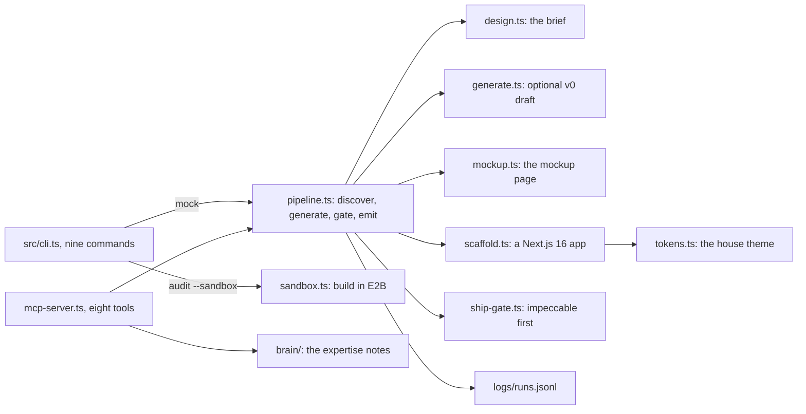

# How Pixel works

Pixel is a frontend specialist you can run from the command line, from an agent or in CI. Give it a one-line brief that names a real person, and it writes a discovery brief, a one-page mockup and a fresh Next.js 16 app. Then it runs an anti-slop check, a scan for the tells of generic AI-made design, and fails the run if the mockup does not pass. It also audits, verifies and migrates existing apps. It is for developers and coding agents who want frontend taste they can enforce, not just describe.

## The parts

[src/cli.ts](../src/cli.ts) registers nine commands: `mock`, `scaffold`, `design`, `generate`, `audit`, `verify`, `migrate`, `cockpit` and `logs`. Each lives in [src/commands/](../src/commands/). The flagship, `mock`, runs the four steps in [src/lib/pipeline.ts](../src/lib/pipeline.ts). [src/commands/design.ts](../src/commands/design.ts) writes the brief. [src/lib/mockup.ts](../src/lib/mockup.ts) builds the mockup page from the brief. [src/commands/scaffold.ts](../src/commands/scaffold.ts) creates the app and adds the colors, fonts and motion easing in [src/lib/tokens.ts](../src/lib/tokens.ts). [src/lib/ship-gate.ts](../src/lib/ship-gate.ts) is the gate. Its first step runs `impeccable detect`, the anti-slop scanner, and only a finding from that step fails the run.

[src/lib/grep-set.ts](../src/lib/grep-set.ts) holds text searches for outdated Next.js and Tailwind patterns, shared by `verify` and [src/lib/taste-check.ts](../src/lib/taste-check.ts). [src/mcp-server.ts](../src/mcp-server.ts) is an MCP server: MCP (Model Context Protocol) is the standard way coding agents call outside tools. Six of its eight tools mirror commands. The other two are `pixel_taste_check`, for a code snippet, and `pixel_brain_search`, over [brain/](../brain/). [src/lib/sandbox.ts](../src/lib/sandbox.ts) builds an app inside an E2B microVM, a small isolated cloud machine. [src/cockpit/server.mjs](../src/cockpit/server.mjs) serves a local page with the brain, the run log, the eval scores and a gallery of mockups.

## What happens when you run it

1. `pixel mock "<brief>" --out ./demo` goes from [src/cli.ts](../src/cli.ts) to [src/commands/mock.ts](../src/commands/mock.ts), which calls `runMockPipeline` in [src/lib/pipeline.ts](../src/lib/pipeline.ts). An empty brief stops here with exit code 2.
2. Discover: `runDesign` in [src/commands/design.ts](../src/commands/design.ts) writes `brief.md`. It is a six-section brief built around the named person, with what they must see first, second and third.
3. Generate: `runGenerate` in [src/commands/generate.ts](../src/commands/generate.ts) asks the v0 Platform API for a draft only when `V0_API_KEY` is set and the `v0-sdk` package loads. Otherwise it skips, and the run goes on. A draft is saved as `v0-draft.json` and marked untrusted.
4. Gate, part one: `buildMockupHtml` in [src/lib/mockup.ts](../src/lib/mockup.ts) writes `mockup/index.html` from the brief. No model is called.
5. Gate, part two: `runScaffold` in [src/commands/scaffold.ts](../src/commands/scaffold.ts) creates the app with `create-next-app`, runs `shadcn init` when it can, and writes the house theme. Offline, the app is skipped and the run goes on with the mockup alone.
6. Gate, part three: `runShipGate` in [src/lib/ship-gate.ts](../src/lib/ship-gate.ts) runs `impeccable detect` over the mockup folder. The other six gate steps need a running app or a person, so they are logged as skipped.
7. Emit: each of the four steps appends its own line to `logs/runs.jsonl` through [src/lib/logger.ts](../src/lib/logger.ts). The command exits 1 if impeccable reported findings.

## Extending it

- **A command.** Add a file in [src/commands/](../src/commands/) and register it in [src/cli.ts](../src/cli.ts). Document its contract in [AGENTS.md](../AGENTS.md), and cover it in [test/cli.test.mjs](../test/cli.test.mjs).
- **An MCP tool.** Add it to [src/mcp-server.ts](../src/mcp-server.ts). [test/contract.test.mjs](../test/contract.test.mjs) checks the tool list, so update it too.
- **A golden task.** Add an entry to [eval/golden-tasks/tasks.mjs](../eval/golden-tasks/tasks.mjs) with its level, whether it blocks CI, and a `run` check. Put a correct example in [eval/fixtures/good/](../eval/fixtures/good/) and a broken one in [eval/fixtures/bad/](../eval/fixtures/bad/), so the check has teeth.
- **A stale-pattern rule.** Add it to [src/lib/grep-set.ts](../src/lib/grep-set.ts). `verify` and `pixel_taste_check` both pick it up.
- **A pinned version.** Update `PINS` in [workflows/rsi.workflow.js](../workflows/rsi.workflow.js) and [brain/TOOL-MATRIX.md](../brain/TOOL-MATRIX.md) together.
- **A skill.** Add `skills/<name>/SKILL.md` in [skills/](../skills/). Credit any outside author in [CREDITS.md](../CREDITS.md).

Then run `pnpm build && pnpm test && npm run eval`. CI also runs [eval/acceptance.mjs](../eval/acceptance.mjs), in [.github/workflows/ci.yml](../.github/workflows/ci.yml).

## Questions

**Does it need an API key or cost money?** The core path needs no key: `mock`, `scaffold`, `design`, `audit`, `verify`, the MCP server and the cockpit. `generate` needs `V0_API_KEY` and the `v0-sdk` package. `audit --sandbox` needs `E2B_API_KEY`.

**Does any data leave the machine?** `mock`, `scaffold`, `audit` and `migrate` download tools from npm through `npx`, and `shadcn init` reads the shadcn registry. `generate` sends your brief to the v0 Platform API. `audit --sandbox` uploads the app's source to E2B. The cockpit listens on 127.0.0.1 only, and the run log stays in `logs/runs.jsonl`.

**How does it improve itself?** Its [dsip.json](../dsip.json) meets DSIP level L2 by Darwin's DSIP checker. The checker verifies L2 from the repository: the acceptance test and evals block pull requests, and the nightly loop opens its proposal as an issue. A nightly workflow, [.github/workflows/rsi.yml](../.github/workflows/rsi.yml), runs [workflows/rsi.workflow.js](../workflows/rsi.workflow.js). It compares 15 pinned package versions with npm and runs the deterministic golden tasks. A moved pin becomes a `BRAIN-DRIFT.md` proposal, kept as a run artifact. The loop also posts it as one open issue labelled `proposal`, and later runs update that issue for a person to review. The loop never edits the brain and never merges.

**How do I run its tests and evals?** Run `pnpm install && pnpm build`, then `pnpm test` for the Node tests in [test/](../test/). `npm run eval` runs [eval/eval.mjs](../eval/eval.mjs) over the golden tasks. A task that needs a running app is a skip, not a pass. [eval/acceptance.mjs](../eval/acceptance.mjs) runs `pixel mock` end to end and boots the app for a browser smoke test.

**What does it not do?** In the ship gate, only impeccable runs for real. Accessibility, Lighthouse, the design audit, security and visual proof are logged as skipped. If `npx` cannot fetch impeccable, that step is skipped, not failed. The v0 draft does not feed the mockup or the app. `pixel mock` never builds in E2B: it accepts `--no-sandbox`, but only `pixel audit --sandbox` uses E2B. The code notes that a full Next.js install runs out of memory in E2B's default 512 MB template. The sandbox gate then records a failure that names the cause.

## More

- [before-after.png](before-after.png): a typical AI-made pricing page that the gate rejects, beside a Pixel mockup that passes.
